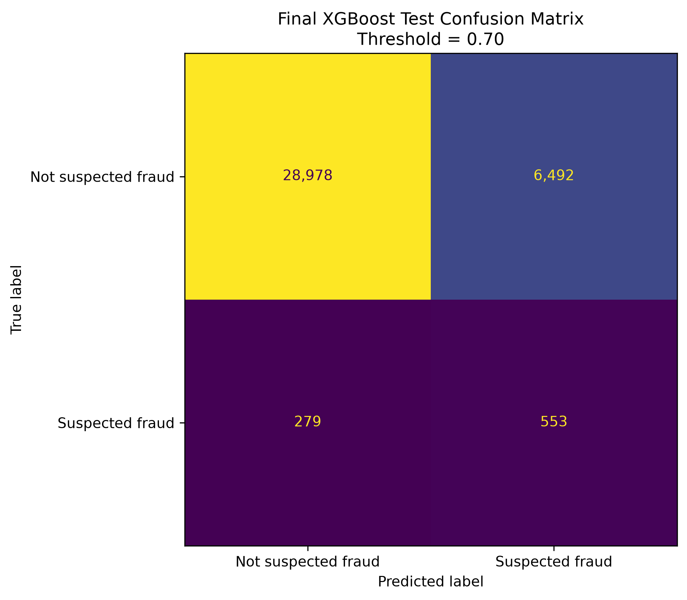
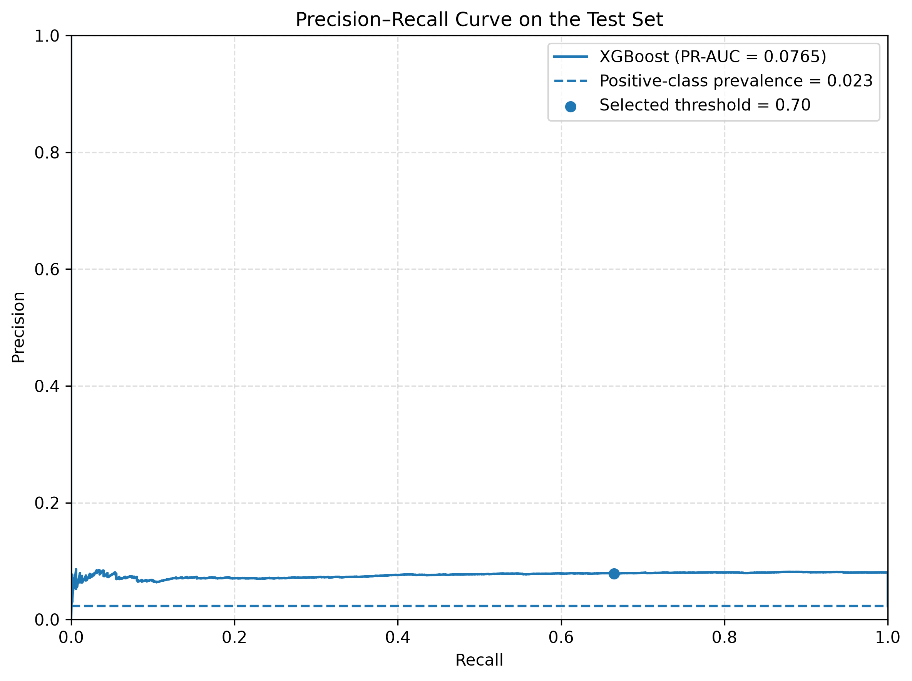

# LLM-Powered Supply Chain Risk and Fraud Detection

**Name & Roll No.:** Ardra J - 2025EMAI10011

**Course:** DSC624 — Natural Language Processing and Large Language Models

**Assignment:** Task 2 - LLM-Powered Supply Chain Risk and Fraud Detection

**GitHub Repository:** https://github.com/ArdraJ0361/supply-chain-risk-detection

**Submission Date:** 07-11-2026

## Abstract

In this study, the impact of using pretrained text embeddings on fraud detection in supply chain system is investigated against traditional machine learning features. It is represented as a DataCo SMART Supply Chain Dataset that is a structured XGBoost Classifier, a semi-supervised Isolation Forest, an embedding-based XGBoost model using MiniLM embeddings and a hybrid model, which combines structured and text embeddings. The data has been divided by Order Id to prevent overlaps within the data.
Training, validation and test sets. Precision-Recall Area Under the Curve (PR-AUC) and ROC-AUC were used as metrics for the models. The result of the structured XGBoost model was 0.0765 PR-AUC and 0.8620 ROC-AUC, and the precision-recall was 66.47% and 7.85% at the decision threshold of 0.70. While a structured XGBoost model outperformed the hybrid model by at most 0.006 (+0.0059, +0.0013, and −0.00002) across three split seeds, a shuffled-embedding control did not reliably improve the hybrid model. All
The results are predominantly driven by the label association of the results in the 4,062 positive labels in the TRANSFER payment type.

## 1. Introduction

The transaction data generated by supply chain management applications consists of many characteristics, such as product data, payment type, customer segment data, geographic data, shipping data, etc. Such transaction analysis may help identify potential frauds for investigation.

Traditional methods of machine learning involve analyzing the structured numerical or categorical features of the data to detect patterns. In contrast, language models learn to encode textual data into dense numerical embeddings. Combining both representations could help in detecting any extra semantic information. Nevertheless, usefulness of the text embeddings would depend upon the amount of textual data present in the dataset.

In this research, the DataCo SMART Supply Chain dataset is used to determine whether pre-trained text embeddings could help in the identification of suspicious transactions marked as frauds. In this study, comparison of structured machine learning, label-filtered (semi-supervised) Isolation Forest anomaly detection baseline, classification using text embeddings and hybrid models is performed.

The previous research provided sentence level embeddings to enable better use of semantic representations for similarity and other natural language processing (NLP) tasks (Reimers & Gurevych, 2019), while MiniLM uses self-attention distillation to build compactly pretrained Transformer embeddings (Wang et al., 2020). In case of imbalanced classification, PR analysis may be more insightful than ROC analysis (Saito & Rehmsmeier, 2015).

### Research Objectives

This study (1) compares structured XGBoost, Isolation Forest, MiniLM embedding-only, and hybrid models; (2) tests the effect of removing payment `Type`; and (3) evaluates split sensitivity and shuffled-embedding controls using metrics suited to an imbalanced target.

## 2. Dataset and Preprocessing

### 2.1 Dataset Description

This DataCo SMART Supply Chain Dataset is provided by Kaggle. This dataset has 53 columns and 180,519 rows. The target variable was created from the `Order Status` field: The records that were marked as `SUSPECTED_FRAUD` were considered as positive samples, and all other records were considered as negative samples.

Approximately 2.25% of the records were positive (4,062 records). The unbalanced distribution of the classes makes accuracy a poor indicator of model performance.

**Dataset source:** [DataCo SMART Supply Chain Dataset](https://www.kaggle.com/datasets/shashwatwork/dataco-smart-supply-chain-for-big-data-analysis)

### 2.2 Data Cleaning and Feature Selection

A first look of the data revealed that there were missing values in several columns, with the absence of the `Product Description` column completely, and the `Order Zipcode` column being largely missing. Predictors were limited to identifiers, personal information or dummy contact fields that were not necessary.

Features that do not relate to outcome and/or do not follow the outcome were also removed to prevent information leakage, such as `Order Status`, `Delivery Status`, actual shipping duration, late-delivery risk, and shipping date; only to be used for grouping in dataset splitting when needed.

Median was used for the imputation of numerical features. Categorical values were represented by a special missing category and categorical variables were one-hot encoded. The structured model had 9 numerical and 10 categorical predictors.

### 2.3 Data Splitting

The data was partitioned into training, validation and test sets at the order level, based on the Order Id, and stratified to ensure equal numbers per Order Id. This made sure that the same order's record wasn't split more than once.

The split sizes were 108,360 training, 35,857 validation, and 36,302 test records (60:20:20), with no `Order Id` shared across splits. There were 832 positive examples in the test set. We have extracted text embeddings from eight fields: product, category, customer-segment, market, geographic and shipping.

## 3. Methodology

### 3.1 Structured XGBoost Classifier

The supervised classification models primarily adopted were XGBoost (Chen & Guestrin, 2016). It encoded the numerical features and the categorical features with one-hot encoding, and replaced the missing numerical features with the median. The classifier had 300 estimators, a maximum tree depth of 5, learning rate 0.05 and a positive class weighting strategy to counteract class imbalance.

### 3.2 Isolation Forest

Isolation Forest (Liu et al., 2008) is used as a label-filtered (semi-supervised) anomaly detection baseline. This was done using 9 numeric transaction and location features and 200 trees (n_estimators=200). Median imputation was fitted to the training data and the detector was fitted to only those training records marked as non-fraud. Records were ranked using anomaly scores and the cutoff was determined to highlight about the observed prevalence of the positive class. It was compared with the validation data that is labelled.

### 3.3 Text Embeddings

The pretrained `sentence-transformers/all-MiniLM-L6-v2` sentence encoder converted eight selected textual and categorical fields into 384-dimensional embeddings. For each record, fields were formatted as `Column: value` and joined with ` | ` (for example, `Product Name: ... | Category Name: ...`). MiniLM is a sentence encoder which generates embeddings, but not a generative large language model. Standardization of embeddings performed with training-set statistics, without PCA dimensionality reduction.

To see if these semantic representations could distinguish records labeled as suspected fraud, an embedding-only XGBoost classifier was trained.

### 3.4 Hybrid Model and Feature Ablation

The hybrid model featured the addition of structured predictors to MiniLM embeddings. It was compared with a structured-only and embedding-only approach.

For further investigation, data on payment transaction `Type` was removed from the structured and hybrid models in a feature-ablation experiment. The strength of the obtained results for this experiment were analyzed for the effects of payment type.

### 3.5 Evaluation Metrics and Threshold Selection

Average precision, expressed as PR-AUC, was the most important evaluation metric due to the small number of suspected-fraud records. Other metrics included were ROC-AUC, precision, recall, and F1-score.

Validation set was used to select the decision threshold with the criterion of maximizing the F1 score. The threshold of 0.70 was then used on the test set that had been held out. The test set was not used for thresholding but only for final evaluation.

### 3.6 Multi-Seed and Control Experiments

In multi-seed experiments, the divisions of data were performed using three different seed numbers: 42, 21 and 7. Since all the seeds have performed exactly the same split, this is more a test of sensitivity to the split than an external test. For the multi-seed classification metrics (F1 score) the decision threshold of 0.5 was calculated, which differs from the 0.70 used in the final experiments. A control experiment for the hybrid model with aligned embeddings against hybrid model with shuffled embeddings was conducted to study the effect of alignment of text embeddings to the record embeddings in hybrid models. The TRANSFER-only rule has been defined as a base level because it makes a prediction of the positive class for the records in which the payment Type is set to `TRANSFER`. But, its PR-AUC is not as standard as that of continuous model scores.

## 4. Experimental Results

### 4.1 Model Comparison

In the single seed-42 validation comparison, structured and hybrid XGBoost had similar PR-AUC, while the embedding-only and Isolation Forest baselines were near the positive-class prevalence. Across seeds, results did not show a reliable difference between structured and hybrid models.

| Model | PR-AUC | ROC-AUC |
|---|---:|---:|
| Structured XGBoost | 0.0837 | 0.8740 |
| Hybrid XGBoost | 0.0817 | 0.8703 |
| Structured without `Type` | 0.0226 | 0.5211 |
| Hybrid without `Type` | 0.0219 | 0.4971 |
| Embeddings-only XGBoost | 0.0212 | 0.4875 |
| Isolation Forest | 0.0210 | 0.4800 |

*Table 1. Standardized validation-set model comparison.*

### 4.2 Multi-Seed and Control Results

The below results are presented as mean ± standard deviation of split seeds 42, 21 and 7. The only difference is in the split seed, and of course all runs are done with the same data set. F1 is reported at a set threshold of 0.5. The TRANSFER-only rule's PR-AUC cannot be compared with the score-based model PR-AUC directly.

| Model | PR-AUC (mean ± SD) | ROC-AUC (mean ± SD) | F1 (mean) |
|---|---:|---:|---:|
| Structured XGBoost | 0.0802 ± 0.0033 | 0.8681 ± 0.0056 | 0.151 |
| Hybrid (aligned embeddings) | 0.0826 ± 0.0002 | 0.8696 ± 0.0018 | 0.148 |
| Hybrid (shuffled embeddings) | 0.0806 ± 0.0033 | 0.8688 ± 0.0048 | 0.148 |
| TRANSFER-only rule | 0.0810 ± 0.0031 | 0.8684 ± 0.0031 | 0.150 |
| Embeddings-only | 0.0226 ± 0.0010 | 0.4936 ± 0.0134 | 0.041 |
| Structured without `Type` | 0.0227 ± 0.0009 | 0.5006 ± 0.0149 | 0.040 |
| Hybrid without `Type` | 0.0225 ± 0.0006 | 0.4965 ± 0.0152 | 0.041 |

*Table 2. Multi-seed comparison across three split seeds.*

In these tests none of the models is consistently superior to the TRANSFER-only rule. The small advantage in PR-AUC (0.0826 vs. 0.0802) for the hybrid does not clearly exceed the bounds of seed variation and the shuffled-embedding control does not provide a reliable embedding benefit. The detailed multi-seed results are stored in `results/multiseed_model_comparison_summary.csv`; shuffled-embedding and Type-control results are in `results/shuffled_embedding_and_type_control_summary.csv`.

### 4.3 Payment Type and Rule Baseline

| Payment type | Rows | Suspected-fraud records | Suspected-fraud rate |
|---|---:|---:|---:|
| TRANSFER | 49,883 | 4,062 | 8.14% |
| CASH | 19,616 | 0 | 0.00% |
| DEBIT | 69,295 | 0 | 0.00% |
| PAYMENT | 41,725 | 0 | 0.00% |

There are 4,062 positive labels, all in the category TRANSFER. A rule marking all TRANSFER orders on this held out test split gave precision 0.0805, recall 1.0000 and F1 0.1489, compared to F1 0.1404 for the structured XGBoost model with threshold 0.70. The rule's PR-AUC is reported from binary predictions, and thus cannot be compared directly with the score-based model PR-AUC.

### 4.4 Final Test Evaluation

The structured XGBoost model was evaluated on the held-out test set using the validation-selected threshold of 0.70.

| Metric | Test result |
|---|---:|
| PR-AUC (Average Precision) | 0.0765 |
| ROC-AUC | 0.8620 |
| Precision | 7.85% |
| Recall | 66.47% |
| F1-score | 0.1404 |
| Decision threshold | 0.70 |

*Table 3. Final test-set performance (held-out test split).*

A confusion matrix was created (Figure 1) with 28,978 true negatives, 6,492 false positives, 279 false negatives and 553 true positives. The precision–recall curve (Figure 2) exhibits a high level of precision (around 0.08) for almost all values of recall, significantly higher than the positive-class prevalence (0.023), but with no operating point in the curve providing high precision. The model managed to identify around 66.5% of positive records, but with a precision of 7.85% means that the majority of positive records that were flagged were not marked as suspected fraud. Across thresholds from 0.05 to 0.70, validation F1 was almost flat (0.145–0.149), therefore the threshold of 0.70 should not be interpreted as a meaningful tuning gain, rather it was selected because the model achieved validation F1 of 0.1488 on this test split at that threshold.

<table style="width:100%; table-layout:fixed;">
<tr>
<td style="width:50%; text-align:center; vertical-align:top; padding:5px;">

Figure 1. Test-set confusion matrix at threshold 0.70.

</td>

<td style="width:50%; text-align:center; vertical-align:top; padding:5px;">

Figure 2. Test-set precision–recall curve; dashed line indicates positive-class prevalence.

</td>
</tr>
</table>

## 5. Discussion

There is no reliable difference between the structured version of XGBoost and the hybrid approach from multi-seed analysis of performance. The random embedding control also shows no significant benefit in terms of text embeddings. The positive labels are all labelled TRANSFER and the models without this variable are near chance. It appears that the performance here is more dependent on the structure of the labels, not any additional semantics in the embeddings. All 8 embedded fields had the same information in the baseline data, as one-hot features, so the embeddings re-encoded information the baseline already had. This finding thus confirms that there is no benefit to re-encoding short categorical fields here, and does not exclude benefits from richer free text.

## 6. Limitations and Conclusion

The current study makes use of the SUSPECTED_FRAUD flag of the dataset instead of fraud outcomes which are independently verified. For the dataset, there is a high correlation between the two as all 4,062 positive records have the Type TRANSFER. No other combination models, such as MiniLM, Structured XGBoost, and TRANSFER (with flag) with no embeddings, are outperformed.

The class balance, shorter text columns and single dataset used are limiting factors for the current results. More studies are needed to ensure features are present during prediction and to incorporate more text information and fraud verification.

## References

<ol style="font-size:8pt; line-height:1.05; margin-top:2px; padding-left:18px;">

<li style="margin-bottom:3px;">
Reimers, N., &amp; Gurevych, I. (2019). Sentence-BERT: Sentence Embeddings using Siamese BERT-Networks. <em>Proceedings of EMNLP-IJCNLP 2019</em>, 3982–3992. <a href="https://doi.org/10.18653/v1/D19-1410">DOI</a>.
</li>

<li style="margin-bottom:3px;">
Liu, F. T., Ting, K. M., &amp; Zhou, Z.-H. (2008). Isolation Forest. <em>2008 Eighth IEEE International Conference on Data Mining</em>, 413–422. <a href="https://doi.org/10.1109/ICDM.2008.17">DOI</a>.
</li>

<li style="margin-bottom:3px;">
Chen, T., &amp; Guestrin, C. (2016). XGBoost: A Scalable Tree Boosting System. <em>Proceedings of the 22nd ACM SIGKDD International Conference on Knowledge Discovery and Data Mining</em>, 785–794. <a href="https://doi.org/10.1145/2939672.2939785">DOI</a>.
</li>

<li style="margin-bottom:3px;">
Wang, W., Wei, F., Dong, L., Bao, H., Yang, N., &amp; Zhou, M. (2020). MiniLM: Deep Self-Attention Distillation for Task-Agnostic Compression of Pre-Trained Transformers. <em>Advances in Neural Information Processing Systems 33</em>. <a href="https://papers.nips.cc/paper/2020/hash/3f5ee243547dee91fbd053c1c4a845aa-Abstract.html">Paper</a>.
</li>

<li style="margin-bottom:3px;">
Saito, T., &amp; Rehmsmeier, M. (2015). The Precision-Recall Plot Is More Informative than the ROC Plot When Evaluating Binary Classifiers on Imbalanced Datasets. <em>PLOS ONE, 10</em>(3), e0118432. <a href="https://doi.org/10.1371/journal.pone.0118432">DOI</a>.
</li>

<li style="margin-bottom:3px;">
DataCo SMART Supply Chain Dataset. Kaggle. <a href="https://www.kaggle.com/datasets/shashwatwork/dataco-smart-supply-chain-for-big-data-analysis">Dataset link</a>.
</li>

</ol>
