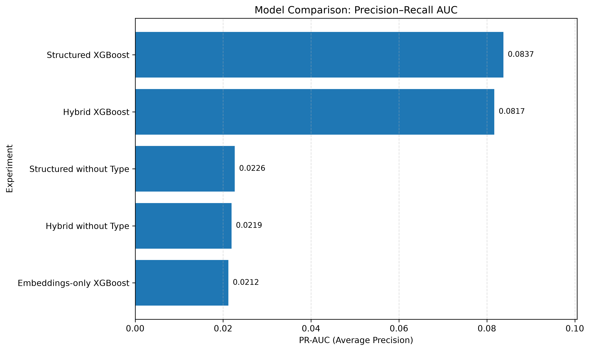
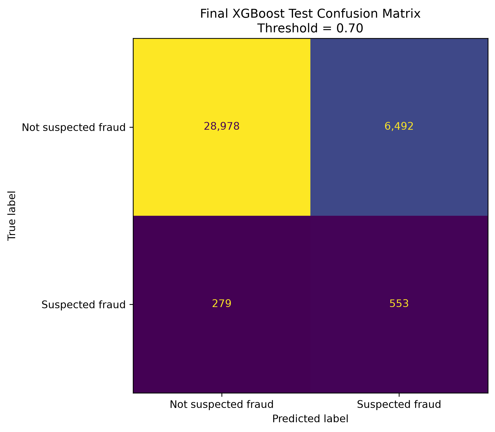
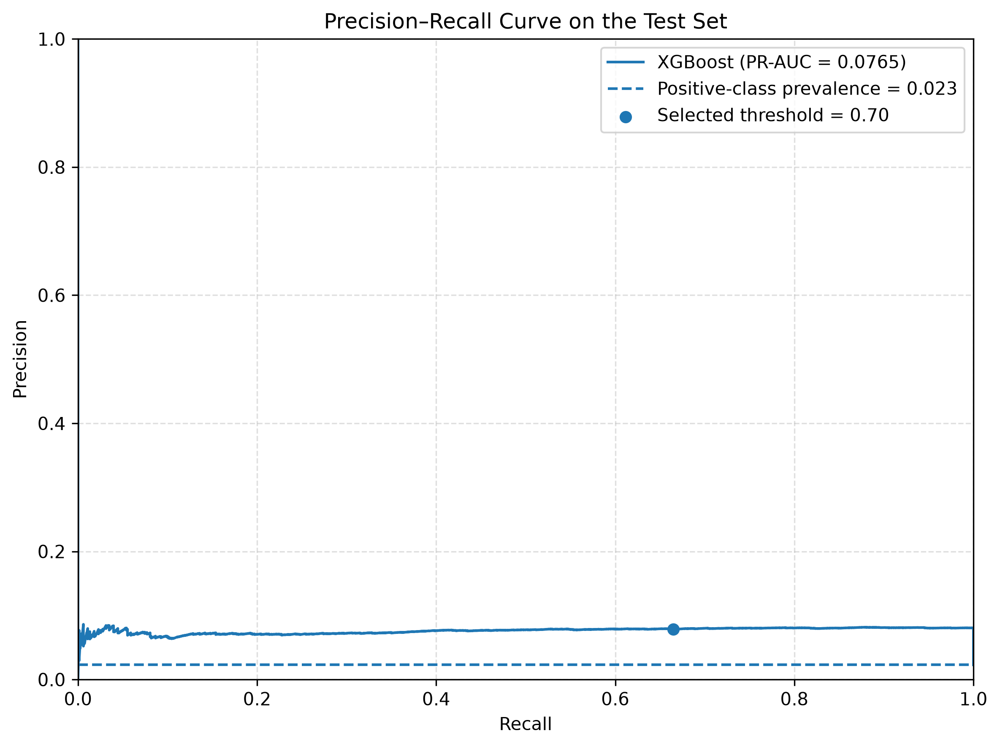

# LLM-Powered Supply Chain Risk and Fraud Detection

**Course:** DSC624 — Natural Language Processing and Large Language Models

**Assignment:** Task 2 — LLM-Powered Supply Chain Risk & Fraud Detection

**Student Name:** Ardra J

**Student ID:** 2025EMAI10011

**Submission Date:** 15-11-2026

## Abstract

Supply chain systems generate large volumes of transaction, product, and customer data that can be used to identify potentially suspicious activities. This study investigates whether pretrained text embeddings improve suspected-fraud detection compared with traditional structured machine-learning features. Using the DataCo SMART Supply Chain Dataset, the study compares a structured XGBoost classifier, an Isolation Forest anomaly-detection model, an embedding-only XGBoost model using MiniLM, and a hybrid model combining structured features with text embeddings.

To avoid records from the same order appearing across different datasets, the data were divided into training, validation, and test sets grouped by Order Id. Model performance was evaluated primarily using Precision–Recall Area Under the Curve (PR-AUC), alongside ROC-AUC, precision, recall, and F1-score. The structured XGBoost model achieved a test PR-AUC of 0.0765 and ROC-AUC of 0.8620. At a decision threshold of 0.70, it achieved 66.47% recall and 7.85% precision. On the seed-42 validation split, the hybrid model did not outperform the structured baseline. Across three split seeds, the hybrid model had a slightly higher mean PR-AUC, but shuffled-embedding controls did not establish a reliable benefit from the embeddings. Feature-ablation experiments also revealed a strong association between payment transaction type and the target label. These findings suggest that structured features were more useful than the selected text embeddings for this dataset, although the results are limited by class imbalance, low precision, and the dataset's suspected-fraud labels.

## 1. Introduction

Supply chain management systems generate substantial amounts of transactional data, including product information, payment types, customer segments, geographical details, and shipping information. Analysing these data can help identify records that warrant further investigation for potential fraud.

Traditional machine-learning approaches use structured numerical and categorical features to identify patterns in data. In contrast, pretrained language models can represent textual information as dense numerical embeddings. Combining these representations may help capture additional semantic information. However, the usefulness of text embeddings depends on the amount and nature of textual information available in the dataset.

This study uses the DataCo SMART Supply Chain Dataset to investigate whether pretrained text embeddings improve the detection of records labelled as suspected fraud. The study compares structured machine learning, unsupervised anomaly detection, text-embedding-based classification, and hybrid modelling.

### Research Objectives

1. Develop a structured-data XGBoost classifier for suspected-fraud detection.

2. Evaluate Isolation Forest as an unsupervised anomaly-detection baseline.

3. Investigate pretrained MiniLM embeddings for transaction-related textual and categorical fields.

4. Compare structured, embedding-only, and hybrid feature representations.

5. Examine the influence of payment transaction type through feature-ablation experiments.

6. Evaluate the selected model on a held-out test set using metrics suitable for an imbalanced classification problem.

## 2. Dataset and Preprocessing

### 2.1 Dataset Description

The DataCo SMART Supply Chain Dataset was obtained from Kaggle. The dataset contains 180,519 records and 53 columns. The target variable was derived from the `Order Status` field: records labelled `SUSPECTED_FRAUD` were treated as positive examples, while all other records were treated as negative examples.

There were 4,062 positive records, representing approximately 2.25% of the dataset. This class imbalance makes accuracy alone an unsuitable measure of model performance.

**Dataset source:** [DataCo SMART Supply Chain Dataset](https://www.kaggle.com/datasets/shashwatwork/dataco-smart-supply-chain-for-big-data-analysis)

### 2.2 Data Cleaning and Feature Selection

Initial inspection identified missing values in several columns. `Product Description` was entirely missing, while `Order Zipcode` was mostly missing. Unnecessary identifiers, personal information, and dummy contact fields were excluded from the predictors.

Potentially outcome-related or post-outcome features, including `Order Status`, `Delivery Status`, actual shipping duration, late-delivery risk, and shipping date, were excluded to reduce information leakage. `Order Id` was retained only for grouping records during dataset splitting.

Numerical features were imputed using the median. Missing categorical values were represented by a designated missing category, and categorical variables were one-hot encoded. The structured model used nine numerical and ten categorical predictors.

### 2.3 Data Splitting

The data were divided into training, validation, and test sets using a 60:20:20 split grouped by `Order Id` and stratified at the order level. This ensured that records belonging to the same order did not appear in multiple splits.

The held-out test set contained 36,302 records, including 832 positive examples. Text embeddings were generated using the pretrained `sentence-transformers/all-MiniLM-L6-v2` model from eight fields containing product, category, customer-segment, market, geographic, and shipping information.

## 3. Methodology

### 3.1 Structured XGBoost Classifier

XGBoost was used as the primary supervised classification model. It processed numerical features and one-hot-encoded categorical features, with missing numerical values imputed using the median. The classifier was configured with 300 estimators, a maximum tree depth of 5, a learning rate of 0.05, and a positive-class weighting strategy to address class imbalance.

### 3.2 Isolation Forest

Isolation Forest was evaluated as an unsupervised anomaly-detection baseline. It was fitted using numerical transaction and location features from the non-positive training records. Anomaly scores were used to rank records, with the decision cutoff set to flag approximately the observed positive-class prevalence. Its performance was compared against the labelled validation data.

### 3.3 Text Embeddings

The pretrained `sentence-transformers/all-MiniLM-L6-v2` model was used to convert eight selected textual and categorical fields into 384-dimensional numerical embeddings. These fields included product and category information, customer segment, market, order region, order country, and shipping mode.

An embedding-only XGBoost classifier was trained to investigate whether these semantic representations could distinguish records labelled as suspected fraud without the structured feature set.

### 3.4 Hybrid Model and Feature Ablation

The hybrid model combined structured predictors with MiniLM embeddings. Its performance was compared with the structured-only and embedding-only approaches.

Feature-ablation experiments removed the payment transaction `Type` feature from the structured and hybrid models. This experiment investigated how strongly the observed results depended on payment type.

### 3.5 Evaluation Metrics and Threshold Selection

Average precision, reported as PR-AUC, was the primary evaluation metric because suspected-fraud records represented only a small proportion of the dataset. ROC-AUC, precision, recall, and F1-score were also reported.

The decision threshold was selected using the validation set by maximizing F1-score. The selected threshold of 0.70 was then applied to the held-out test set. The test set was reserved for final evaluation rather than threshold selection.

## 4. Experimental Results

### 4.1 Model Comparison

The structured XGBoost model achieved the highest PR-AUC among the supervised experiments, with a validation PR-AUC of 0.0837. The hybrid model achieved 0.0817, showing no improvement over the structured baseline. The embedding-only model achieved 0.0212, close to the positive-class prevalence.

| Model | PR-AUC | ROC-AUC |
|---|---:|---:|
| Structured XGBoost | 0.0837 | 0.8740 |
| Hybrid XGBoost | 0.0817 | 0.8703 |
| Structured without `Type` | 0.0226 | 0.5211 |
| Hybrid without `Type` | 0.0219 | 0.4971 |
| Embeddings-only XGBoost | 0.0212 | 0.4875 |

*Table 1. Standardized validation-set model comparison.*

### 4.2 Final Test Evaluation

The structured XGBoost model was evaluated on the held-out test set using the validation-selected threshold of 0.70.

| Metric | Test result |
|---|---:|
| PR-AUC (Average Precision) | 0.0765 |
| ROC-AUC | 0.8620 |
| Precision | 7.85% |
| Recall | 66.47% |
| F1-score | 0.1404 |
| Decision threshold | 0.70 |

*Table 2. Final test-set performance.*

The confusion matrix contained 28,978 true negatives, 6,492 false positives, 279 false negatives, and 553 true positives. Although the model identified approximately 66.5% of positive records, its precision was only 7.85%, indicating that most flagged records were not labelled as suspected fraud.

## 5. Discussion

On the standardized seed-42 validation comparison, structured XGBoost outperformed the embedding-only and hybrid approaches. In the supplementary three-seed analysis, the hybrid model had a slightly higher mean PR-AUC than the structured model, but the shuffled-embedding control suggests that this small difference is not robust evidence of added value. The selected text fields mainly contained short categorical labels, product names, and geographical information. These fields may not have provided enough additional semantic information for pretrained embeddings to improve classification.

The feature-ablation experiment revealed that removing the payment transaction `Type` feature reduced validation PR-AUC from 0.0837 to 0.0226 for the structured model. Dataset analysis also showed that all records labelled `SUSPECTED_FRAUD` had `Type = TRANSFER`. This strong association may explain much of the model's predictive performance.

However, feature importance does not establish causation. The availability of transaction type at the intended prediction time must be verified to rule out potential information leakage. The Isolation Forest baseline also performed poorly, achieving a validation PR-AUC of 0.0210 and ROC-AUC of 0.4800.

### Embedding Controls and Multi-Seed Robustness

To investigate the contribution of pretrained text embeddings, additional experiments were conducted using three order-level data splits with random seeds 42, 21, and 7. The structured XGBoost and hybrid XGBoost models were compared with an embeddings-only model and versions of the structured and hybrid models that excluded the payment transaction type feature.

Across the three splits, the structured XGBoost model achieved a mean PR-AUC of 0.0802, while the hybrid model achieved 0.0826. Although the hybrid model had a slightly higher mean PR-AUC, the difference was small. The embeddings-only model achieved a mean PR-AUC of 0.0226 and a mean ROC-AUC of 0.4936, indicating limited predictive value from the selected text embeddings.

Removing the payment transaction type feature reduced mean PR-AUC to approximately 0.0225–0.0227. Further analysis showed that all records labelled as suspected fraud had the transaction type TRANSFER. This association suggests that model performance was strongly influenced by a dataset-specific relationship rather than necessarily reflecting broader fraud-detection capabilities.

A shuffled-embedding control was also conducted to investigate whether correctly aligned embeddings improved the hybrid model. The aligned hybrid model achieved a mean PR-AUC of 0.0826, compared with 0.0806 for the shuffled-embedding model. This comparison is descriptive: the difference is small, and the shuffled model performed better on one of the three seeds. The small difference, together with inconsistent results across individual splits, does not establish that the embeddings provide a reliable improvement.

A simple rule that flagged every TRANSFER record achieved 100% recall and a mean F1-score of 0.1499, compared with 0.1483 for the aligned hybrid model. However, this rule would flag many records that were not labelled as suspected fraud. Its PR-AUC is based on binary predictions and should not be interpreted as directly equivalent to the ranking-based PR-AUC of models that produce continuous scores.

These experiments suggest that the selected text embeddings provide limited additional predictive value for this dataset. The strong association between transaction type and the target label also raises concerns about shortcut learning and the generalisability of the results. The multi-seed experiments are treated as a split-sensitivity analysis rather than independent final evaluations because the splits originate from the same underlying dataset.

## 6. Limitations and Conclusion

This study uses the dataset's `SUSPECTED_FRAUD` label rather than independently verified fraud outcomes. The final model achieved 66.47% recall but only 7.85% precision, meaning that many flagged records were not labelled as suspected fraud. Therefore, the model should be considered an experimental screening aid requiring human review, not an automated fraud-determination system.

The experiments also rely on a single dataset, and their generalizability to other supply-chain environments has not been established. The text fields are limited, and the predictive contribution of payment type requires further investigation.

In conclusion, structured XGBoost was the strongest supervised approach among those evaluated, while MiniLM embeddings did not improve performance. Future work should investigate feature availability at prediction time, evaluate richer document-based text, test on independently verified outcomes, and select operating thresholds according to practical review capacity.

## References

1. DataCo SMART Supply Chain Dataset. Kaggle. https://www.kaggle.com/datasets/shashwatwork/dataco-smart-supply-chain-for-big-data-analysis

2. Sentence Transformers. `all-MiniLM-L6-v2` pretrained model. https://huggingface.co/sentence-transformers/all-MiniLM-L6-v2

3. XGBoost Documentation. https://xgboost.readthedocs.io/

4. Scikit-learn Documentation. `Isolation Forest`. https://scikit-learn.org/stable/modules/generated/sklearn.ensemble.IsolationForest.html

## Code Availability

Source code and experiment instructions: https://github.com/ArdraJ0361/supply-chain-risk-detection

## Supporting Figures

### Figure 1. Validation-set model comparison

*Figure 1. Comparison of PR-AUC across the five model experiments on the validation set.*

### Figure 2. Final test-set confusion matrix

*Figure 2. Confusion matrix for the final XGBoost model on the held-out test set at a decision threshold of 0.70.*

### Figure 3. Precision–recall curve

*Figure 3. Precision–recall curve for the final XGBoost model on the held-out test set. The dashed line indicates the positive-class prevalence.*
